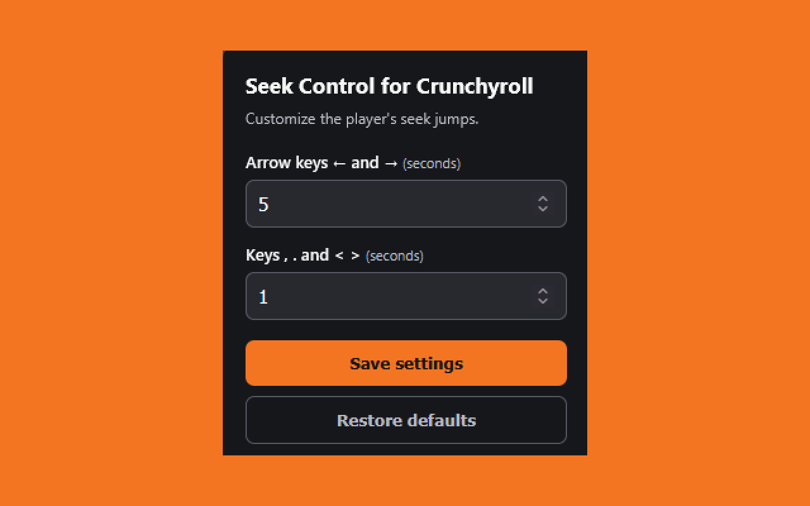

# Seek Control for Crunchyroll

Manifest V3 browser extension to customize the seek duration on Crunchyroll. Not affiliated with or endorsed by Crunchyroll.

## Features

- Left and right arrows: configurable jump (default: 5 seconds).
- `,` and `.` keys, or `<` and `>`: configurable fine jump (default: 1 second). Works with the dedicated `<>` key on Spanish keyboards and with Shift+`,` / Shift+`.` on US keyboards.
- Settings are stored in the browser and apply without reloading the episode.
- English and Spanish interface, chosen automatically from the browser's language (English is the default).
- No external services, no dependencies, no data collection. See [PRIVACY.md](PRIVACY.md).

## Install from source

### Firefox

1. Download or clone this repository.
2. Open `about:debugging#/runtime/this-firefox`.
3. Click **Load Temporary Add-on**.
4. Select `extension/manifest.json`.
5. Open or reload Crunchyroll and play an episode.
6. Click the extension icon to configure the jumps.

Temporary add-ons are removed when Firefox restarts.

### Chrome

1. Download or clone this repository.
2. Open `chrome://extensions`.
3. Enable **Developer mode**.
4. Click **Load unpacked** and select the `extension` folder.
5. Open or reload Crunchyroll and play an episode.
6. Click the extension icon to configure the jumps.

## Project structure

- `extension/`: everything that ships in the extension.
  - `manifest.json`: declares the extension and its permissions.
  - `content.js`: listens for keys and controls `video.currentTime`.
  - `popup.html`, `popup.css`, `popup.js`: settings UI.
  - `_locales/en`, `_locales/es`: English and Spanish translations.
  - `icons/`: toolbar and store icons (16, 32, 48, 128 px PNGs) plus `icon.svg`, the editable source.
- `tools/make-icons.js`: regenerates the icons with Node.js (`node tools/make-icons.js extension/icons`).
- `store-assets/`: store screenshots and listing text.

## Packaging

Zip the **contents** of the `extension` folder (so `manifest.json` is at the root of the zip) and upload it to the store. Bump `"version"` in `manifest.json` for every new upload.

## Adding a language

Copy `extension/_locales/en/messages.json` to `extension/_locales/<code>/messages.json` (for example `pt_BR`) and translate each `message` value. The browser picks it up automatically.

## Known limitations

- Tested on a live Crunchyroll session (October 2026). If Crunchyroll changes its player or moves the video somewhere the script can't reach, the script will need adjusting.
- Keys are only intercepted when the event reaches the Crunchyroll page and the `<video>` element is accessible.
- On-screen buttons and remote-control seeks are not modified.

## License

[MIT](LICENSE)
